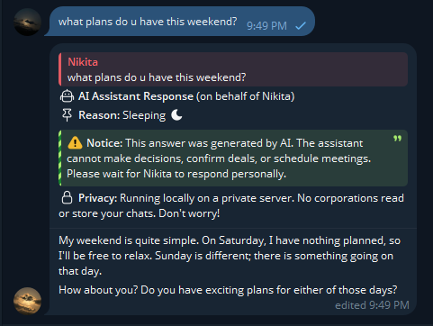
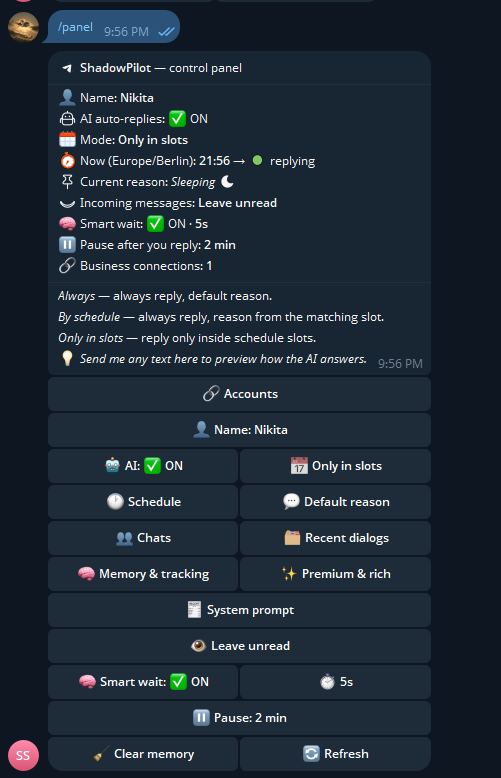
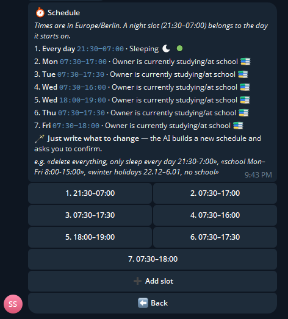
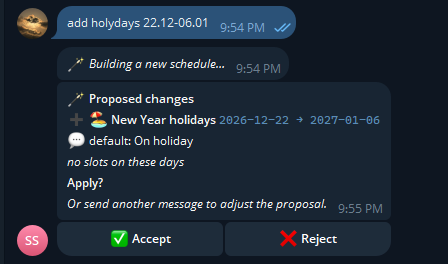
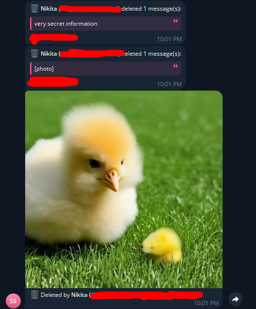
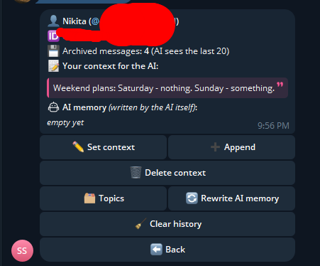
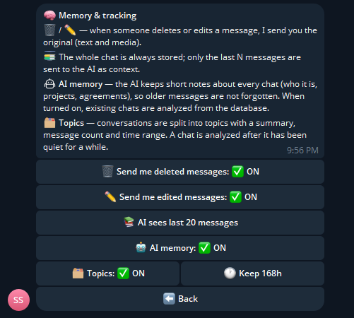
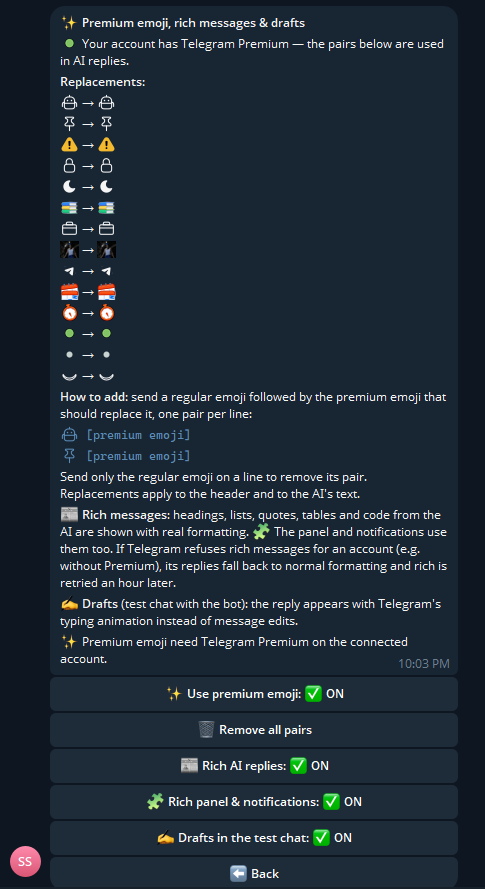
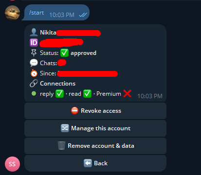

# 🛸 ShadowPilot

> 🧪 **Test build:** uses `telegraf-hardened` from [PR #32](https://github.com/telegraf-hardened/telegraf-hardened/pull/32) (Bot API 10.3: rich messages, drafts), installed from a GitHub commit. The Docker image installs `git` for this. Switch back to the npm release once it is published.

> 🧪 **Beta (v0.1.0-beta).** The features below work and run in daily use, but the project is still in active development. Expect bugs and breaking changes in config and storage between versions. Back up `database/` before updating.

ShadowPilot is a **Telegram Business** bot that answers your private chats with AI while you are away: sleeping, at school, busy.
It runs on your own server. Chats are kept in a local SQLite file and only go to the AI you configure. That can be a **fully local model** (Ollama, LM Studio…) or any OpenAI-compatible API.

Every AI reply is clearly marked. A header **above** the text shows the reason you are unavailable, says that the AI cannot make decisions, and includes a privacy note.

```
🤖 AI Assistant Response (on behalf of Nikita)

📌 Reason: Owner is sleeping right now 🌙

⚠️ Notice: This answer was generated by AI. The assistant cannot make decisions,
confirm deals, or schedule meetings. Please wait for Nikita to respond personally.

🔒 Privacy: Running locally on a private server. No corporations read or store your chats.
━━━━━━━━━━━━━━━
Hi! Nikita is asleep right now, he'll get back to you in the morning…▍
```

---

## 📸 Screenshots

| AI reply in a business chat | Control panel |
|:---:|:---:|
|  |  |
| **Weekly schedule** | **Editing the schedule in plain text** |
|  |  |
| **Deleted messages are sent to you** | **Chat card: your context and AI memory** |
|  |  |
| **Memory & tracking** | **Premium emoji, rich messages & drafts** |
|  |  |
| **Account card (access management)** | |
|  | |

---

## ✅ What's ready (Phase 1)

| Feature | Status |
|---|---|
| Telegram Business integration (`business_connection`, `business_message`) | ✅ |
| AI replies via the official `openai` client: **OpenAI, Ollama, LM Studio, vLLM, OpenRouter, Groq…** (any OpenAI-compatible URL, key optional for local servers) | ✅ |
| Local "thinking" models: `<think>…</think>` reasoning is filtered out of replies | ✅ |
| **Docker** / docker compose | ✅ |
| **Rich messages** (Bot API 10.3): the AI's Markdown (headings, lists, quotes, tables, code) is shown with real formatting; the panel and notifications use rich messages too | ✅ 🧪 |
| **Drafts**: the reply appears with Telegram's typing animation (test chat with the bot only: in business chats Telegram shows drafts from the bot in a separate chat) | ✅ 🧪 |
| Chat history is sent to the AI as a transcript with explicit authors, so the owner's own messages are never taken for the bot's replies | ✅ |
| **Premium (custom) emoji** in replies when the account owner has Telegram Premium, with automatic fallback to regular emoji | ✅ |
| **Live streaming**: the reply appears gradually through `editMessageText` every `streamIntervalMs`, with handling for `429 retry_after` | ✅ |
| Warning/privacy header **above** the reply (`config/texts.json`) | ✅ |
| **Weekly schedule**: time slots per weekday (e.g. school Mon–Fri) with a custom reason each. Night slots like `21:30–07:00` work correctly, and the timezone is configurable | ✅ |
| **Exceptions**: one-off date periods (holidays, vacation) with their own slots and reason | ✅ |
| **🪄 AI schedule editor**: describe changes in plain text and confirm the proposed diff | ✅ |
| 3 modes: `always`, `schedule`, `strict` (reply only inside slots) | ✅ |
| **Full chat archive** in SQLite (kept forever); only the last N messages (panel setting) are sent to the AI | ✅ |
| **Deleted / edited messages**: the bot sends you the original text and media in a private message (toggle) | ✅ |
| **AI memory**: the AI keeps its own short notes per chat, so older context is not lost; existing chats are analyzed on first enable; "🔄 Rewrite AI memory" re-reads the whole chat | ✅ |
| **Recent dialogs**: conversations split into topics with a summary, message count and time range; a topic picks up again when the chat returns to it | ✅ |
| **Smart wait**: batches several messages that form one thought into a single reply | ✅ |
| **Owner pause**: AI stays quiet in a chat for N minutes after you reply there yourself | ✅ |
| **Admin panel** in the bot's private chat (inline buttons) | ✅ |
| **Chat manager**: find a chat by @username / Telegram ID, clear its history, edit your private context for the AI | ✅ |
| Read mode: **mark incoming messages as read** or **leave them unread** | ✅ |
| Test chat: write to the bot to preview how the AI would answer | ✅ |
| **Multi-user with approvals**: anyone can connect the bot to their Telegram Business account, an admin approves or declines; every account has its own settings, chats and memory | ✅ |
| **Admin account switching**: manage any approved account from your own panel | ✅ |
| Startup validation: prints `CRITICAL ERROR` and exits if required `.env` values are missing | ✅ |
| Optional error log channel (`ERRCN`) | ✅ |

### 🎛 Admin panel

Send `/start` or `/panel` to the bot from an owner account:

- 🤖 **AI on/off**
- 📅 **Mode**: Always / By schedule / Only in slots
- 🕐 **Schedule**: weekly slots with days and reason texts, plus exceptions:
  - add a slot manually: `23:00-07:00 Sleeping 🌙`, or enter only the time and pick a preset reason; then 📆 **Days** to choose weekdays
  - 🪄 **or just write what to change** while the schedule is open:
    > *Delete everything, keep only sleep every day 21:30-7:00*

    The AI builds a new schedule. The bot validates it and shows the **exact changes**, calculated by the bot itself rather than taken from the AI's own description:
    > 🗑 Remove the whole current weekly schedule
    > ➕ Every day 21:30–07:00 · Sleeping 🌙
    > **Apply?** ✅ Accept / ❌ Reject

    Send another message to refine the proposal before accepting. Nothing changes until you press ✅.
  - 🏖 **Exceptions** for one-off periods (holidays, vacation, trips): on these dates their own slots **replace** the weekly ones, e.g. *"winter holidays 22.12–6.01, no school, I sleep until 11"*. Past exceptions are marked ⌛️ and can be deleted.
- 💬 **Default reason**: used when no slot matches
- 👁 **Read mode**: *Mark as read* or *Leave unread* (needs the "Read messages" right in Business settings)
- 🧠 **Smart wait** on/off and the wait time (3 / 5 / 8 / 10 s)
- ⏸ **Pause after you reply**: off / 2 / 5 / 15 / 30 / 60 min
- 👥 **Chats**: send `@username` or a Telegram ID (or pick one of the recent chats), then:
  - ✏️ **Set**, ➕ **append to** or 🗑 **delete** your **private context** for this person. It is added to the AI prompt for that chat only, e.g. *"Classmate Dima. 'Banana' is our inside joke about the physics teacher."* The AI uses it but never reveals it.
  - ⏸ **Pause the AI in this chat** for 1 h / 3 h / 8 h / 24 h or until you turn it back on:
    - 🔇 **only auto-replies off**: the bot stays silent here, but archive, deleted/edited tracking, AI memory and topics keep working;
    - 🚫 **AI completely off**: no replies, and messages from this period are never shown to the AI (not in replies, memory or topics, even later). They are still archived for deleted/edited tracking.
  - 🧹 **Clear history** of that chat only
- 🧠 **Memory & tracking**:
  - 🗑 / ✏️ **Send me deleted / edited messages**: when the other person deletes or edits a message, you get the original. Media (photos, voice notes, videos, stickers…) is re-sent as well.
  - 📚 **AI sees last N messages** (10 / 20 / 40 / 80 / 150). The whole chat is always stored, and N only limits the AI context.
  - 🤖 **AI memory**: the AI writes and updates its own notes for each chat: who the person is, projects, agreements, inside jokes. The notes go into the prompt, so older messages are not lost even with a small N. On first enable, existing chats are analyzed from the database.
  - 🗂 **Topics** and how long to keep them (6 h … 7 days).
- 🗂 **Recent dialogs**: topics across all chats, e.g. *"💬 Website project · Dima — discussing the mockup — 📨 14 · 🕐 09.10 14:03–16:40"*. If the chat switches to small talk and then returns to the project, the bot extends the same topic.
- 👤 In a chat card you also see the **AI memory**, its 🗂 **Topics**, and **🔄 Rewrite AI memory**. That last one throws away the AI's notes and topics and re-reads the whole chat from the archive; the bot messages you when it is done. Your own context is not touched.
- ✨ **Premium emoji**: define pairs "regular emoji → premium emoji" by sending them to the bot (`🤖 [premium emoji]`, one pair per line). If the connected account has Telegram Premium, the bot uses the premium versions in the reply header and in the AI's text. Without Premium, or if Telegram rejects the message, regular emoji are sent. The same pairs are applied to everything the bot sends to you: the panel texts, deleted/edited notifications and reports. Button labels stay regular, because Telegram buttons do not support this kind of replacement.
- 🔗 **Accounts** (admins only):
  - when someone connects the bot to their Telegram Business account, every admin gets a request with **✅ Approve / ❌ Reject**, and the person is told to wait;
  - until approval the bot neither answers in their chats nor stores anything from them;
  - the list shows everybody (👑 admin, ✅ approved, ⏳ waiting, ⛔️ declined): approve, **revoke access**, **remove the account with all its data**, or **🔀 manage this account**. That switches your panel into their namespace without changing your Telegram account, and "↩️ Back to my account" returns;
  - approved people get their own `/panel` with their own schedule, name, chats, memory and system prompt (no access management).
- 👤 **Name**: the name the AI uses for you (admins default to `OWNER_NAME`, others to their Telegram name).
- 🧾 **System prompt**: view the AI instruction, replace it with your own (placeholders `{ownerName}`, `{reason}`, `{time}`) or reset it to the default from `config.js`. The chat history with authors, your context and the AI memory are always added on top.
- 🧹 **Clear memory**: deletes everything (archive, AI memory, topics) for all chats

> Chats are analyzed in the background after they have been quiet for `digestIdleMin` minutes (15 by default, in `config.js`), so a live conversation is never cut in the middle. With a local model each chunk takes a few seconds.

Panel changes are stored in SQLite and override the defaults in `config/config.js`.

### 🧠 How smart wait works

People often split one thought across several messages: "hi" → "listen" → "are you free tomorrow?". Replying to each one separately would look silly, so the bot works like this:

1. After every incoming message it waits `debounceMs` (5 s by default). **Each new message restarts the timer.**
2. When the timer ends, it checks whether the batch looks finished:
   - a plain greeting (`hi`, `привет`…) → wait a bit longer, the real question is probably coming;
   - ends with `,` `:` `...` → unfinished, wait;
   - ends with `?` or is long → reply now;
   - anything else → a short AI call ("judge") decides between **REPLY** and **WAIT**.
3. It waits at most `maxExtraWaits` extra times (`extraWaitMs` each), then replies to everything in **one** message.

> ℹ️ **About "is the person typing":** the Telegram **Bot API does not give bots the other person's typing status**. Bots never receive "typing…" events. Smart wait therefore uses a debounce timer plus the AI judge, which is the closest you can get with a bot. Real typing detection would need an MTProto (userbot) session; see the roadmap.

---

## 🗺 Roadmap (planned)

- ⌨️ **Real typing detection** through an optional MTProto session, so smart wait can see that the other person is still typing.
- 🎙 Voice message transcription (Whisper) so the AI understands voice notes.
- 📇 Per-chat rules: whitelist/blacklist contacts, custom instructions per contact.
- 📊 Daily digest: a summary of what the AI answered while you were away.
- 🌐 Localized admin panel (RU/EN).

---

## 🚀 Setup

**Requirements:** Telegram Premium (needed for Telegram Business), an AI provider (OpenAI key **or** a local Ollama…), and Docker **or** Node.js 18+.

1. Create a bot with [@BotFather](https://t.me/BotFather) and turn on **Business Mode** in its settings (`Bot Settings → Business Mode`).
2. Install and configure:
   ```bash
   npm install
   cp .env.example .env   # fill in BOT_TOKEN, OWNER, AI_*, OWNER_NAME, TIMEZONE
   ```
3. Run **either** with Docker:
   ```bash
   docker compose up -d --build
   docker compose logs -f
   ```
   **or** directly with Node.js:
   ```bash
   npm start
   ```
4. In Telegram: **Settings → Telegram Business → Chatbots**, add your bot and allow it to **reply to messages** (and **read messages** if you want the "Mark as read" mode).
5. Open the bot and send `/panel`.

### `.env`

| Variable | Required | Description |
|---|---|---|
| `BOT_TOKEN` | ✅ | Bot token |
| `OWNER` | ✅ | Admin Telegram user id(s), comma separated. Admins are always allowed and approve everyone else |
| `AI_BASE_URL` | | OpenAI-compatible endpoint. Default `https://api.openai.com/v1` |
| `AI_API_KEY` | only for api.openai.com | Key; leave empty for Ollama / LM Studio |
| `AI_MODEL` | | Default `gpt-4o-mini` |
| `AI_REASONING_EFFORT` | | Optional `none`/`low`/`medium`/`high`, sent only when set |
| `AI_JUDGE_TIMEOUT_MS` | | Max time for the smart-wait judge (default 15000); after it the bot just replies |
| `OWNER_NAME` | | Your name in prefixes/prompt |
| `TIMEZONE` | | IANA timezone for the schedule, e.g. `Europe/Moscow` (default: server timezone) |
| `DB_PATH` | | Default `./database/shadow_pilot.db` |
| `ERRCN` | | Chat/channel id for error logs |
| `AI_ENABLED` | | `false` disables AI completely |

### 🧩 AI providers

| Provider | `AI_BASE_URL` | `AI_API_KEY` |
|---|---|---|
| OpenAI | `https://api.openai.com/v1` | required |
| Ollama (same machine) | `http://127.0.0.1:11434/v1` | — |
| LM Studio | `http://127.0.0.1:1234/v1` | — |
| OpenRouter | `https://openrouter.ai/api/v1` | required |
| Groq | `https://api.groq.com/openai/v1` | required |

The old `OPENAI_API_KEY` / `OPENAI_BASE_URL` / `OPENAI_MODEL` names still work.

### 🐳 Docker notes

- `docker-compose.yml` uses `network_mode: host`, so the container reaches an AI server on the host at `127.0.0.1` (Ollama listens there by default). The bot uses long polling and exposes no ports.
- The database is in the named volume `shadowpilot-data` and survives rebuilds.
- Update after code changes: `docker compose up -d --build`.

### Commands (owner only)

| Command | Description |
|---|---|
| `/start`, `/panel` | Open the control panel |
| `/reset` | Clear the test chat history |
| `/cancel` | Cancel the current panel input |

---

## 📁 Structure

```
shadow-pilot/
├── config/
│   ├── config.js              # All settings (defaults)
│   └── texts.json             # All user-facing texts, prefix, disclaimers, panel strings
├── database/                  # SQLite file (auto-created)
├── src/
│   ├── admin/panel.js         # Owner control panel + AI test chat
│   ├── ai/
│   │   ├── openai.js          # OpenAI streaming + "is the thought finished?" judge
│   │   ├── memory.js          # History of the owner's test chat
│   │   ├── digest.js          # Topics + AI memory prompts
│   │   └── scheduleEditor.js  # Free text -> validated schedule JSON
│   ├── db/
│   │   ├── sqlite.js          # DB init & schema
│   │   ├── settings.js        # Runtime settings (panel overrides)
│   │   ├── members.js         # Accounts that connected the bot + approval status
│   │   ├── chats.js           # Known chats (@username/id lookup) + per-chat AI context
│   │   ├── archive.js         # Full message archive (AI context, deleted/edited tracking)
│   │   ├── topics.js          # Recent dialogs (topics)
│   │   └── connections.js     # Business connections cache
│   ├── handlers/
│   │   ├── business.js        # business_connection / business_message
│   │   ├── access.js          # Approval requests and decisions
│   │   ├── tracking.js        # Edited / deleted messages -> owner
│   │   ├── digestWorker.js    # Background topics + AI memory updates
│   │   ├── smartWait.js       # Per-chat debounce queue
│   │   └── streamRenderer.js  # Placeholder + periodic editMessageText
│   ├── utils/
│   │   ├── parseToNumberArray.js
│   │   ├── scheduleChecker.js # Active status + reason (weekdays, night slots, exceptions)
│   │   ├── scheduleFormat.js  # Human-readable schedule + diff for AI proposals
│   │   ├── messageText.js     # Message -> one line of text for the AI
│   │   ├── time.js            # Date/time formatting in the owner's timezone
│   │   ├── premiumEmoji.js    # Regular -> custom emoji replacement
│   │   ├── ownerChatApi.js    # Rich + premium emoji for messages to the owner (panel, notifications)
│   │   ├── classicToRich.js   # Classic Telegram HTML -> rich HTML
│   │   ├── markdownToRich.js  # AI Markdown -> rich HTML
│   │   ├── logger.js
│   │   └── text.js
│   └── index.js               # Entry point
├── Dockerfile
├── docker-compose.yml
└── .env.example
```

All texts, including the reply header and panel labels, live in `config/texts.json`. Edit that file to translate or restyle the bot.

---

## 📄 License

Copyright (C) 2026 Nikita Siakin (siakinnik)

ShadowPilot is free software: you can redistribute it and/or modify it under the terms of the
[GNU General Public License v3.0](LICENSE) as published by the Free Software Foundation.

It is distributed in the hope that it will be useful, but **without any warranty**; without even the implied
warranty of merchantability or fitness for a particular purpose. See the [LICENSE](LICENSE) file for details.

Third-party packages keep their own licenses, all GPLv3-compatible: MIT (`telegraf-hardened`, `better-sqlite3` and the rest),
BSD-2-Clause (`dotenv`) and Apache-2.0 (`openai`). Their license texts ship inside `node_modules`.
